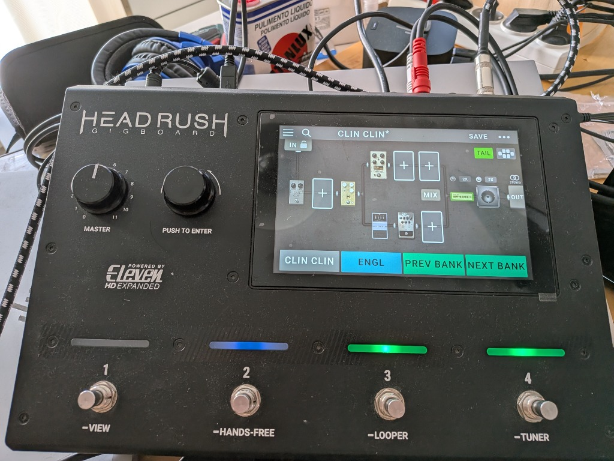
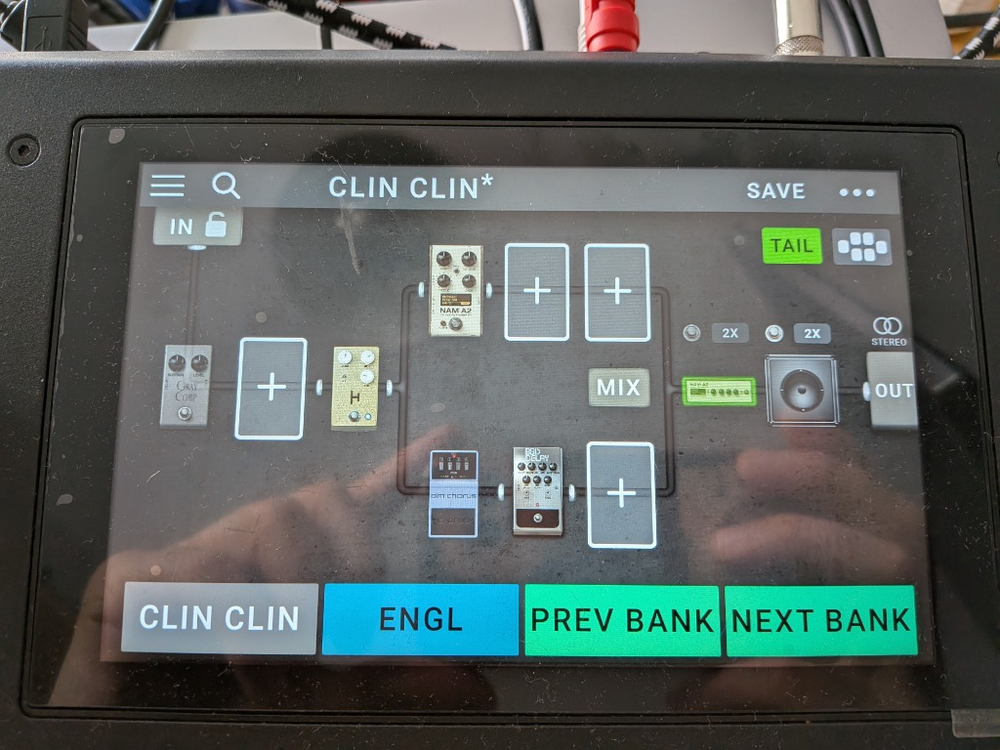
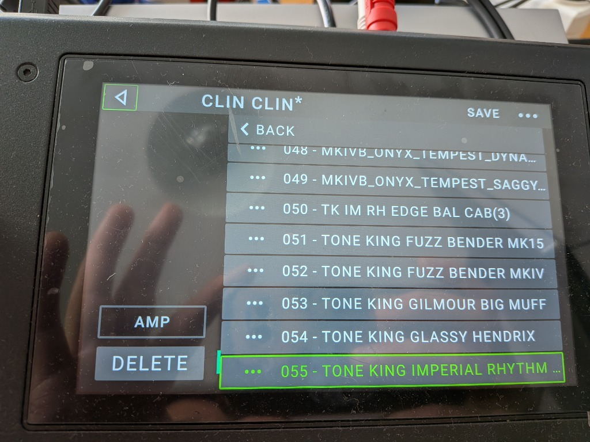
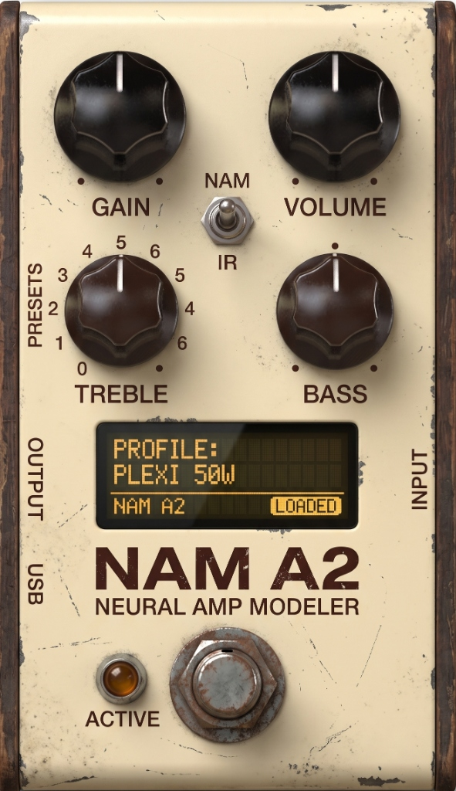
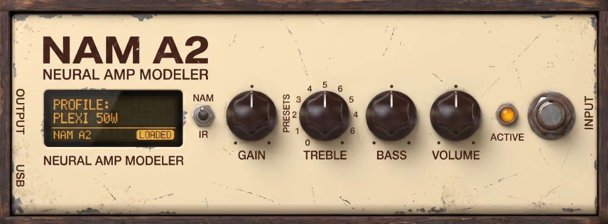

# HeadRush Gigboard — Neural Amp Modeler (NAM) Mod

[](LICENSE)
[](#)
[](https://github.com/sdatkinson/NeuralAmpModelerCore)
[](https://github.com/iosumurillo/GIGBOARD_NAM_AMP_PNG/releases/tag/v2.7-nam-extended)

Modificación avanzada de firmware para **HeadRush Gigboard** (con compatibilidad para MX5 y Pedalboard) con **Firmware 2.7**, que integra de forma nativa la inferencia de redes neuronales [Neural Amp Modeler (NAM)](https://github.com/sdatkinson/NeuralAmpModelerCore) directamente en el motor de audio en tiempo real (`/usr/Evil/Evil`).

### 📥 Descargas Oficiales de Producción (Releases)

Para instalar el mod en tu pedalera sin necesidad de compilar código fuente:

| Archivo | Descripción | Descarga Directa |
| :--- | :--- | :--- |
| **Firmware Updater (NAM A2 extended mod)** | Flasheador automático para HeadRush Gigboard con soporte Dual NAM + Amp + Tone Stack | [⬇️ Descargar .exe](https://github.com/iosumurillo/GIGBOARD_NAM_AMP_PNG/releases/download/v2.7-nam-extended/HeadRush.gigboard.Firmware.Updater.NAM.A2.extended.mod.exe) |
| **HeadRush NAM Block Manager** | Gestor de perfiles `.nam`, ordenación USB y generador de `.block` para Windows 10/11 | [⬇️ Descargar .exe](https://github.com/iosumurillo/GIGBOARD_NAM_AMP_PNG/releases/download/v2.7-nam-extended/HeadRush_NAM_Block_Manager.exe) |

> 📦 **Página de la Release**: [v2.7 Extended Edition](https://github.com/iosumurillo/GIGBOARD_NAM_AMP_PNG/releases/tag/v2.7-nam-extended)  
> 📖 **Guía técnica y manual de usuario detallado**: [GUIA_NAM_HEADRUSH.md](GUIA_NAM_HEADRUSH.md)

---

## 📸 Demostración en Hardware Real (HeadRush Gigboard)

<p align="center">
  
</p>

<p align="center">
  
  
</p>

### 🎨 Gráficos Integrados en el Motor QML/RCC de HeadRush

| Bloque Pedal: Anxiety OD (NAM) | Bloque Amplificador: 82 LEAD 800 (NAM) |
| :---: | :---: |
|  |  |
| *Diseño vertical para pedal de sobremarcha en la cadena* | *Cabezal apaisado con control de EQ activo de 3 bandas y Presence* |

---

## ⚡ Características Principales

- **Doble Bloque NAM en Cadena**:
  - **Pedal Anxiety OD (NAM)** (y Anxiety OD V2): Inferencia transparente como pedal de saturación/overdrive con controles de Input Trim, Level y selector de modelo.
  - **Amplificador 82 LEAD 800 (NAM)**: Cabezal completo con inferencia NAM y **Tone Stack Activo** de 3 bandas (Bass a 100 Hz, Mid a 750 Hz, Treble a 3.5 kHz, Presence a 6 kHz) y filtro **Tight Cut HPF** a 150 Hz conmutable.
- **Inferencia de Ultra Baja Latencia**:
  - Motor compilado con soporte vectorial ARM Cortex-A9 NEON (`-mfpu=neon-vfpv4 -mfloat-abi=hard`).
  - Hilo de audio en tiempo real protegido contra caídas de buffer (*underruns*).
- **Transición Suave Duck & Switch**:
  - Rampa matemática de coseno elevado (*raised-cosine*) de 100 ms al cambiar de perfil, eliminando ruidos, clicks o zumbidos digitales.
- **Precarga en Segundo Plano**:
  - El análisis y lectura de perfiles `.nam` desde la unidad USB se realiza en un hilo de baja prioridad para no bloquear la interfaz gráfica ni el audio.
- **Gráficos Integrados en Pantalla Táctil**:
  - Gráficos integrados en los recursos QML/RCC de HeadRush: pedal vertical para Anxiety OD y cabezal horizontal apaisado para 82 LEAD 800.
- **HeadRush NAM Block Manager GUI**:
  - Herramienta de escritorio moderna incluida en `tools/` para detectar pendrives USB, ordenar modelos alfabéticamente, calibrar trims y generar automáticamente bloques `.block` de presets listos para usar.
- **100+ Bloques Presets Incluidos**:
  - En la carpeta `presets/Blocks_Para_Tu_Gigboard` encontrarás bloques ya generados para carga instantánea.

---

## 📁 Estructura del Repositorio

```text
Gigboard_NAM/
├── app/                  # Frontend de la aplicación updater de escritorio (C)
├── blobs/                # Binarios ARM precompilados (libnam_hook.so, libnam_preload.so, trampolines)
├── core/                 # Motor de parcheo de firmware (ELF, QML, EXT4, FIT image, assets)
│   ├── generated/        # Blobs ARM embebidos en C mediante bin2c
│   └── *.c / *.h         # Pipeline de reconstrucción y parcheo de firmware
├── docker/               # Entorno Docker para compilación cruzada reproducible
├── docs/                 # Documentación técnica adicional y guía de recuperación
├── patch/                # Código fuente en C++ del hook de audio en tiempo real
│   ├── nam_hook.cpp      # Motor de audio DSP, tone stack, duck & switch y dual NAM
│   └── nam_preload.cpp   # Preload de hilos en segundo plano y llamadas de sistema
├── presets/              # Bloques listos para transferir a la HeadRush Gigboard
│   └── Blocks_Para_Tu_Gigboard/
│       ├── ANXIETY OD/
│       └── ANXIETY OD V2/
├── scripts/              # Scripts de compilación y toolchains (WSL / Linux)
├── third_party/          # Dependencias embebidas (miniz, nuklear, sha1)
├── tools/                # Herramientas de utilidad y GUI
│   ├── headrush_block_manager_gui.py  # GUI de gestión de bloques y USB
│   ├── dev_scripts/                   # Scripts de ingeniería inversa y análisis
│   └── ...
├── CMakeLists.txt        # Configuración principal de CMake
├── GUIA_NAM_HEADRUSH.md  # Manual técnico y guía completa de usuario
├── LICENSE               # Licencia GPLv3
└── README.md             # Esta documentación
```

---

## 🎛️ Mapeo de Controles

### Bloque Pedal: Anxiety OD (NAM)

| Control | Rango | Función Técnica |
| :--- | :--- | :--- |
| **Tone** | 0% – 100% | **Input Trim**: 50% = Ganancia Unitaria (0.0 dB). 0% = Mute, 100% = +12 dB. |
| **Drive** | 0% – 100% | **Selector de Modelo NAM**: Selecciona el archivo `.nam` correspondiente del pendrive USB (`0%` = Archivo 0, `100%` = Archivo 100). |
| **Level** | 0% – 100% | **Output Trim**: 50% = Salida Unitaria (0.0 dB). 0% = Mute, 100% = +12 dB. |
| **On/Off**| Bypass | Paso en seco directo (*dry passthrough*). |

---

### Bloque Amplificador: 82 LEAD 800 (NAM)

| Página | Control | Rango | Función Técnica |
| :--- | :--- | :--- | :--- |
| **Pág 1** | **Gain** | 0% – 100% | Ganancia de entrada previa a la red neuronal (50% = 0 dB). |
| **Pág 1** | **Presence** | 0% – 100% | Filtro High-Shelf activo en 6 kHz ($\pm 10\text{ dB}$, 50% = plano). |
| **Pág 1** | **Master** | 0% – 100% | Nivel de salida general post-inferencia y EQ (50% = 0 dB). |
| **Pág 2** | **Bass** | 0% – 100% | Filtro Low-Shelf centrado en 100 Hz ($\pm 12\text{ dB}$, 50% = plano). |
| **Pág 2** | **Mid** | 0% – 100% | Filtro Peaking en 750 Hz, $Q=1.0$ ($\pm 12\text{ dB}$, 50% = plano). |
| **Pág 2** | **Treble** | 0% – 100% | Filtro High-Shelf en 3.5 kHz ($\pm 12\text{ dB}$, 50% = plano). |
| **Pág 3** | **Depth** | 0% – 100% | **Selector de Modelo NAM**: Mapeo 1:1 exacto alfabético de perfiles USB. |
| **Pág 3** | **Bright** | OFF / ON | **Filtro Tight HPF (150 Hz)**: Elimina graves fangosos antes de la distorsión. |

---

## 🚀 Inicio Rápido

### 1. Cargar Modelos en el Pendrive USB
1. Conecta tu HeadRush Gigboard a la computadora en modo **Transferencia de Archivos USB**.
2. En la raíz del pendrive de HeadRush, crea la carpeta `NAM` (junto a `Rigs`, `Blocks`, etc.).
3. Copia tus capturas `.nam` favoritas. Puedes usar la herramienta incluida:
   ```bash
   python tools/headrush_block_manager_gui.py
   ```
   Esta interfaz auto-detecta la unidad, ordena alfabéticamente los modelos, añade los prefijos `000 - Nombre.nam` y genera los archivos de bloque `.block` en `Blocks/ANXIETY OD` y `Blocks/ANXIETY OD V2`.

### 2. Copiar los Presets Listos
Si deseas presets inmediatos, copia el contenido de `presets/Blocks_Para_Tu_Gigboard` directamente a la carpeta `Blocks` de tu HeadRush Gigboard.

---

## 🛠️ Compilación desde el Código Fuente

### Requisitos
- **Windows**: MinGW-w64 con CMake, o WSL2 (Ubuntu 20.04/22.04).
- **Linux / macOS**: CMake 3.16+, GCC / Clang, libcurl, SDL2, liblzma.
- **Cross-compilación ARM** (opcional, para reconstruir `blobs/`):
  - Toolchain `arm-linux-gnueabihf-g++`
  - Ejecutar `./scripts/fetch_nam_core.sh` para obtener NeuralAmpModelerCore y Eigen.
  - Ejecutar `./scripts/build_blobs.sh`

### Construcción del Updater de Escritorio
```bash
mkdir build && cd build
cmake ..
cmake --build . --config Release
```

---

## ⚠️ Recuperación y Seguridad

El mod preserva la estructura de actualización oficial de HeadRush. Para restaurar el firmware original de fábrica en cualquier momento:
1. Pon la Gigboard en modo actualización de firmware.
2. Ejecuta el actualizador original oficial de HeadRush Firmware 2.7.
3. Para más detalles, consulta [docs/RECOVERY.md](docs/RECOVERY.md).

---

## ⚖️ Licencia

- El código del mod y los hooks de integración están bajo la licencia [GPL v3](LICENSE).
- NeuralAmpModelerCore está bajo la licencia [MIT](https://github.com/sdatkinson/NeuralAmpModelerCore/blob/main/LICENSE).
- Las marcas HeadRush, Gigboard, MX5 y Pedalboard son marcas registradas de inMusic Brands, Inc. Este proyecto es una modificación comunitaria independiente y de código abierto sin afiliación con inMusic Brands.

